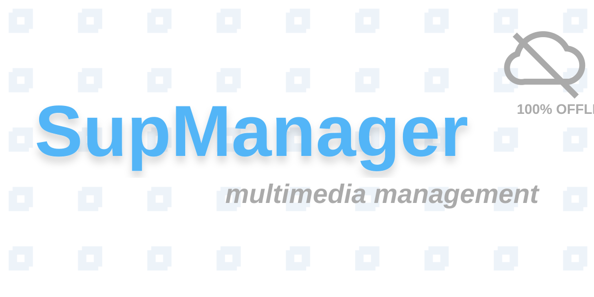
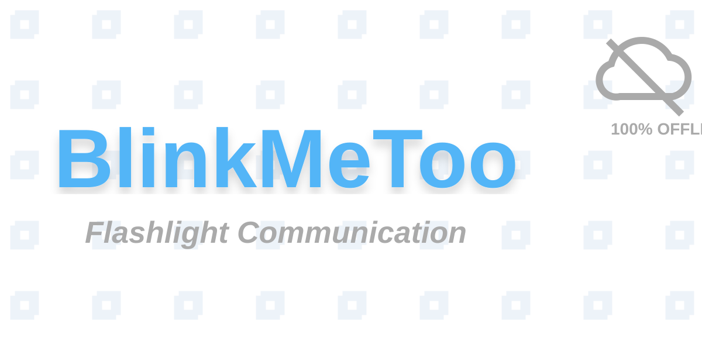
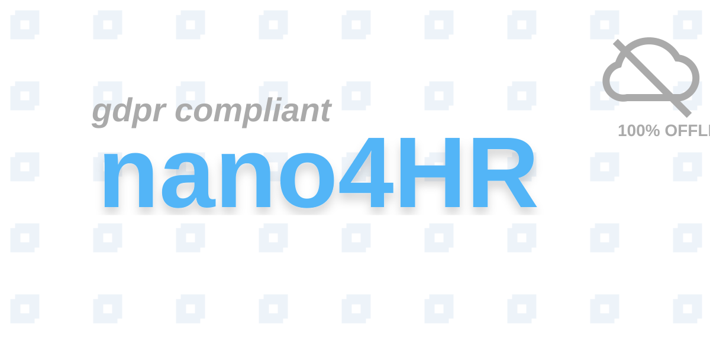
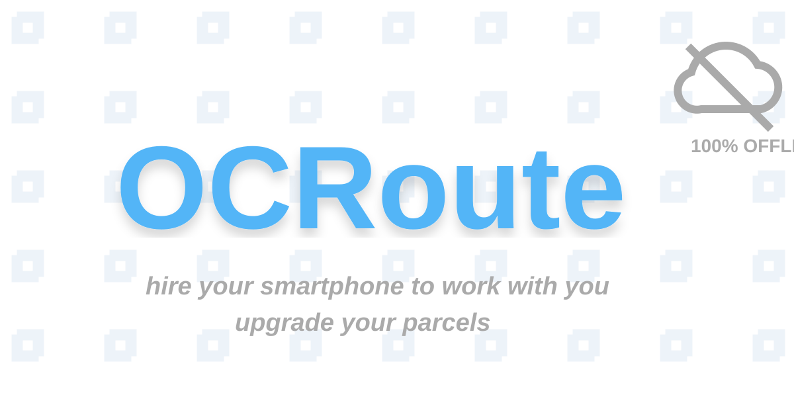
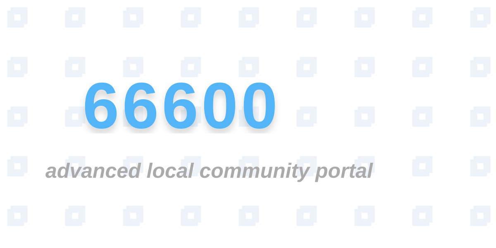

<div align="center">

# DBDevStudio

**Autorski zestaw aplikacji webowych działających w całości po stronie przeglądarki.**

Wszystkie aplikacje przedstawione w tym katalogu zostały zaprojektowane i wykonane
przez autora repozytorium. Żadna z nich nie wymaga backendu, instalacji ani konta —
wystarczy przeglądarka i link do podglądu produkcyjnego.


[](https://htmlpreview.github.io/?https://raw.githubusercontent.com/Dobrychlopak87/ByDBDevStudio/main/index.html)

</div>

---

## O projekcie

DBDevStudio to hub autorskich aplikacji webowych: od menedżera multimediów i narzędzi
HR, przez skanery OCR i planery doręczeń, po zestaw konwerterów przydatnych na co dzień
w pracy dewelopera. Część aplikacji hostowana jest w osobnych repozytoriach, a cztery
samodzielne narzędzia działają bezpośrednio z katalogu `apps/` tego repozytorium.
Wszystkie podglądy produkcyjne uruchamiają pełne, gotowe do użycia wersje aplikacji —
każda pod własnym, osobnym adresem.

---

## Katalog aplikacji

### Aplikacje zewnętrzne (osobne repozytoria)

#### 1. Hyper Multimedia Manager (SupManager)

<p align="center"></p>

Przeglądarka i menedżer plików multimedialnych. Aplikacja działa w 100% offline —
multimedia pozostają na urządzeniu i nie są nigdzie wysyłane.

<p align="center">
&nbsp;[](https://htmlpreview.github.io/?https://raw.githubusercontent.com/Dobrychlopak87/supmanager/main/index.html)&nbsp;
[](https://github.com/Dobrychlopak87/supmanager)
</p>

#### 2. BlinkMeToo

<p align="center"></p>

Aplikacja do komunikacji światłem latarki telefonu — przesyłanie prostych komunikatów
za pomocą sekwencji błysków. Działa w 100% offline.

<p align="center">
&nbsp;[](https://htmlpreview.github.io/?https://raw.githubusercontent.com/Dobrychlopak87/BlinkMeToo/main/index.html)&nbsp;
[](https://github.com/Dobrychlopak87/BlinkMeToo)
</p>

#### 3. nano4HR

<p align="center"></p>

**nano4HR — Your safety is our priority.** Ewidencja czasu pracy i zarządzanie HR.
Zgodna z RODO (GDPR compliant), działająca w 100% offline — dane pracowników
nie opuszczają urządzenia.

<details>
<summary><strong>📱 Pełny opis i niezwykła historia powstania (Mobile-First)</strong> — kliknij, aby rozwinąć</summary>

<br>

**nano4HR** to zaawansowana aplikacja typu Single Page Application (SPA) mieszcząca
się w jednym, autonomicznym pliku HTML (monolicie), stworzona z myślą o wsparciu
procesów BHP, ewidencji czasu pracy oraz zarządzania profilami pracowników HR.
*(EN: an advanced SPA contained entirely within a single, autonomous, monolithic HTML
file, designed to streamline OSH processes, work time registration, and HR employee
profiles.)*

> **📱 Niezwykła historia powstania.** Ta aplikacja powstała w 100% na ekranie telefonu
> komórkowego. Została zbudowana bez użycia tradycyjnego komputera, środowisk IDE czy
> płatnych narzędzi, korzystając wyłącznie z darmowych limitów różnych modeli
> sztucznej inteligencji (LLM). Projekt udowadnia, że przy odpowiedniej determinacji,
> logice i precyzyjnym kierowaniu modelami AI (Prompt Engineering) można stworzyć
> produkcyjne oprogramowanie od zera w każdych warunkach.

**Główne funkcje**

- **Ewidencja czasu pracy i BHP** — pełny moduł rejestrowania i podsumowywania czasu
  pracy, dopasowany do standardów bezpieczeństwa.
- **Walidacja danych biznesowych** — automatyczna walidacja specyficznych
  identyfikatorów takich jak PESEL (z wyliczaniem daty urodzenia) oraz numerów kont
  bankowych (IBAN).
- **Generowanie eksportów (Offline-First)** — ZIP: pakowanie i kompresowanie danych
  w locie bezpośrednio w przeglądarce za pomocą niestandardowego kodu kompresji;
  Excel / CSV / PDF: lokalny eksport tabelaryczny i dokumentowy gotowy do druku.
- **Kopia zapasowa (Backup)** — opcja pobrania pełnego profilu i konfiguracji
  w postaci pliku JSON w celu łatwego przywrócenia stanu.

**Bezpieczeństwo i architektura**

- **Content Security Policy (CSP)** — bardzo restrykcyjna polityka bezpieczeństwa
  oparta o sumy kontrolne SHA-256 dla skryptów i stylów. Zabezpiecza aplikację przed
  atakami typu Cross-Site Scripting (XSS).
- **Kryptografia lokalna** — wbudowane wsparcie dla podpisów cyfrowych (ECDSA/RSA),
  eksportu kluczy publicznych urządzeń oraz potencjał dla uwierzytelniania
  sprzętowego WebAuthn (FIDO2).
- **Strict Mode** — kod JavaScript działa w rygorystycznym trybie `'use strict'`,
  eliminując ciche błędy i optymalizując czas wykonania.
- **Zero External Dependencies (Zero-npm)** — cały kod CSS, JS oraz silniki
  narzędziowe zostały zintegrowane wewnątrz jednego pliku HTML (~514 KB), co pozwala
  na pełne uruchomienie aplikacji offline.

**Jak uruchomić (100% klient — przeglądarka)**

1. Pobierz plik `index.html` z tego repozytorium.
2. Kliknij dwukrotnie plik `index.html`, aby otworzyć go w dowolnej nowoczesnej
   przeglądarce internetowej.
3. Nie jest wymagany żaden serwer ani instalacja.

</details>

<p align="center">
&nbsp;[](https://dobrychlopak87.github.io/nano4HR/)&nbsp;
[](https://github.com/Dobrychlopak87/nano4HR)
</p>

#### 4. OCRoute

<p align="center"></p>

Skaner etykiet OCR i planer doręczeń. Idea projektu: *„hire your smartphone to work
with you — upgrade your parcels"* (zatrudnij swój smartfon do pracy i ulepsz obsługę
przesyłek). Działa w 100% offline.

<p align="center">
&nbsp;[](https://htmlpreview.github.io/?https://raw.githubusercontent.com/Dobrychlopak87/OCRoute/main/index.html)&nbsp;
[](https://github.com/Dobrychlopak87/OCRoute)
</p>

#### 5. 66600.PL

<p align="center"></p>

Lokalny portal społecznościowy dostępny pod własnym adresem internetowym.

<p align="center">
&nbsp;[](https://66600.gt.tc/)
</p>

#### 6. SkanerOCR

Podgląd aplikacji do rozpoznawania tekstu (OCR).

<p align="center">
&nbsp;[](https://htmlpreview.github.io/?https://raw.githubusercontent.com/Dobrychlopak87/SkanerOCR/main/index.html)&nbsp;
[](https://github.com/Dobrychlopak87/SkanerOCR)
</p>

#### 7. QR-gen

Generator kodów QR.

<p align="center">
&nbsp;[](https://htmlpreview.github.io/?https://raw.githubusercontent.com/Dobrychlopak87/QR-gen/main/index.html)&nbsp;
[](https://github.com/Dobrychlopak87/QR-gen)
</p>

### Aplikacje osadzone w tym repozytorium (katalog `apps/`)

#### 8. Edytor tekstu

Lokalny edytor plików tekstowych z wyszukiwaniem w treści i zapisem zmian.
Lekka, samodzielna aplikacja, która działa w całości w przeglądarce — bez
zewnętrznych bibliotek i połączenia z siecią.

<p align="center">
&nbsp;[](https://htmlpreview.github.io/?https://raw.githubusercontent.com/Dobrychlopak87/ByDBDevStudio/main/apps/text-editor/index.html)&nbsp;
[](https://github.com/Dobrychlopak87/ByDBDevStudio/tree/main/apps/text-editor)
</p>

#### 9. DBDevil CONVERT

Zestaw dziesięciu narzędzi deweloperskich w jednej aplikacji:

- **Splitter** — podział tekstu na części z eksportem do ZIP,
- **XML → JSON** — konwersja dokumentów XML do formatu JSON,
- **Dummy data** — generator danych testowych (produkty, transakcje),
- **Regex Lab** — laboratorium wyrażeń regularnych z podświetlaniem i zamianą,
- **Code Cleaner** — uproszczona minifikacja kodu JS/CSS,
- **Color Master** — generowanie palet kolorów na bazie wartości HEX,
- **QR Code Generator** — generowanie kodów QR,
- **Font Base64** — konwersja fontów TTF/OTF/WOFF do reguły `@font-face` z Base64,
- **Photo Optimizer** — optymalizacja zdjęć (eksport JPG do 1024 px),
- **SVG optimize** — upraszczanie kodu SVG z podglądem.

Operacje wykonywane są lokalnie; funkcje ZIP i QR korzystają z bibliotek CDN.

<p align="center">
&nbsp;[](https://htmlpreview.github.io/?https://raw.githubusercontent.com/Dobrychlopak87/ByDBDevStudio/main/apps/dbdevil-convert/index.html)&nbsp;
[](https://github.com/Dobrychlopak87/ByDBDevStudio/tree/main/apps/dbdevil-convert)
</p>

#### 10. Konwerter obrazów Base64

Konwersja obrazów do formatu Base64, Data URI, HTML lub CSS bezpośrednio
w przeglądarce. Przydatna przy osadzaniu grafik w plikach HTML i arkuszach stylów
bez dodatkowych zapytań sieciowych.

<p align="center">
&nbsp;[](https://htmlpreview.github.io/?https://raw.githubusercontent.com/Dobrychlopak87/ByDBDevStudio/main/apps/image-base64/index.html)&nbsp;
[](https://github.com/Dobrychlopak87/ByDBDevStudio/tree/main/apps/image-base64)
</p>

#### 11. Konwerter ZIP do TXT/JSON

Rozpakowywanie archiwów ZIP w przeglądarce i eksport plików do formatów TXT, JSON
lub HTML. Funkcja rozpakowywania wymaga biblioteki JSZip ładowanej z CDN.

<p align="center">
&nbsp;[](https://htmlpreview.github.io/?https://raw.githubusercontent.com/Dobrychlopak87/ByDBDevStudio/main/apps/zip-to-text/index.html)&nbsp;
[](https://github.com/Dobrychlopak87/ByDBDevStudio/tree/main/apps/zip-to-text)
</p>

### Projekt prywatny

#### 12. KurierAI

Repozytorium źródłowe jest prywatne, dlatego aplikacja nie jest udostępniona
w publicznym podglądzie produkcyjnym. Publiczny podgląd będzie możliwy po
zapewnieniu publicznego hostingu aplikacji.

<p align="center">
&nbsp;[](https://github.com/Dobrychlopak87/KurierAI)
</p>

---

## Podglądy produkcyjne — jak to działają

- **nano4HR** ma już włączone natywne **GitHub Pages** i otwiera się bezpośrednio pod
  własnym adresem [dobrychlopak87.github.io/nano4HR](https://dobrychlopak87.github.io/nano4HR/).
  Plik serwowany jest bez zmian, więc restrykcyjna polityka CSP (sumy SHA-256) działa
  w nienaruszonej formie.
- Pozostałe podglądy korzystają z usługi **htmlpreview.github.io**, która pobiera plik
  z `raw.githubusercontent.com` i renderuje go w przeglądarce — bez strony pośredniej
  i bez ostrzeżeń. Uwaga: htmlpreview modyfikuje strukturę dokumentu, dlatego nie
  nadaje się dla aplikacji z restrykcyjnym CSP — dokładnie dlatego nano4HR ma
  własny, natywny hosting.
- Każda aplikacja ma własny, oddzielny adres podglądu — linki znajdują się
  w katalogu powyżej oraz w hubie (`index.html`):
  [Uruchom katalog aplikacji](https://htmlpreview.github.io/?https://raw.githubusercontent.com/Dobrychlopak87/ByDBDevStudio/main/index.html).
- Wskazówka: po włączeniu GitHub Pages dla pozostałych repozytoriów (Settings → Pages →
  Deploy from a branch → gałąź `main`, katalog `/ (root)`) każda aplikacja zyska trwały,
  natywny adres `https://dobrychlopak87.github.io/<repo>/` — wtedy wszystkie podglądy
  można przełączyć całkowicie na GitHub Pages.

## Prywatność i bezpieczeństwo

- Aplikacje przetwarzające pliki wykonują wszystkie operacje lokalnie
  w przeglądarce — pliki użytkownika nie opuszczają urządzenia.
- Wyjątkiem są funkcje korzystające z bibliotek publicznych CDN (np. QR, ZIP),
  które wymagają dostępu do sieci — sama konwersja danych nadal odbywa się lokalnie.
- Na współdzielonych urządzeniach nie należy otwierać aplikacji z danymi poufnymi.

## Struktura repozytorium

```text
ByDBDevStudio/
├── index.html              # hub — katalog wszystkich aplikacji z linkami do podglądów
├── README.md               # ten plik
├── apps/
│   ├── text-editor/        # Edytor tekstu
│   ├── dbdevil-convert/    # DBDevil CONVERT — 10 narzędzi deweloperskich
│   ├── image-base64/       # Konwerter obrazów Base64
│   └── zip-to-text/        # Konwerter ZIP do TXT/JSON
└── assets/
    ├── supmanager.svg      # banner — Hyper Multimedia Manager
    ├── blinkmetoo.svg      # banner — BlinkMeToo
    ├── nano4hr.svg         # banner — nano4HR
    ├── ocroute.svg         # banner — OCRoute
    └── 66600.svg           # banner — 66600.PL
```

---

<div align="center">

**DBDevStudio** — wszystkie aplikacje w tym katalogu to autorskie projekty autora repozytorium.

*W przeglądarce. Bez backendu. Bez wysyłania danych na serwer.*

</div>
